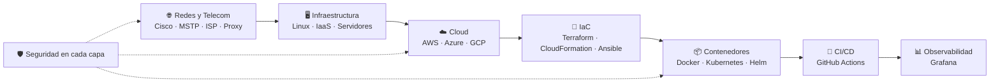

---

## 👨‍💻 Sobre mí

Tengo formación en **Ingeniería de Telecomunicaciones**, así que entiendo la infraestructura **desde la capa física hasta la aplicación**: cómo viaja un paquete por la red de un ISP, cómo se aprovisiona un servidor en la nube, cómo se despliega un contenedor en Kubernetes y cómo se protege todo eso.

Trabajo en la intersección de **Cloud, DevOps, Redes y Ciberseguridad**. Automatizo infraestructura con **Terraform, Ansible y CloudFormation**, orquesto servicios con **Docker y Kubernetes** y practico seguridad ofensiva en laboratorios aislados para diseñar sistemas más difíciles de romper.

---

## 🎯 ¿Por qué trabajar conmigo?

<table>
<tr>
<td width="50%" valign="top">

### 🧩 Visión integral

No veo la infraestructura por partes. Cuando algo falla, puedo seguir el problema **de la red al servidor, del servidor al contenedor y del contenedor al pipeline**, sin depender de cinco personas distintas.

- Hablo el idioma de **redes**, **sistemas**, **desarrollo** y **seguridad**.
- Diseño pensando en el sistema completo: costo, disponibilidad, seguridad y operación.
- Sirvo de puente entre equipos de infraestructura y de desarrollo.

</td>
<td width="50%" valign="top">

### ⚡ Aprendizaje rápido

Mi stack es amplio porque **aprendo herramientas nuevas rápido y las llevo a la práctica**, no solo a la teoría.

- Trabajo con **tres nubes**: AWS, Azure y GCP.
- Uso **tres enfoques de IaC**: Terraform, CloudFormation y Ansible.
- Cada proyecto que hago queda **documentado con evidencias**, para que cualquiera del equipo lo pueda reproducir.

</td>
</tr>
</table>

### 🗺️ Mi visión de la infraestructura, de punta a punta

---

## 💼 Lo que aporto a tu equipo

| Área | Qué puedo hacer |
|---|---|
| ☁️ **Cloud** | Diseñar y desplegar infraestructura en AWS, Azure (IaaS, AKS, Functions) y GCP. |
| 📜 **Infraestructura como código** | Convertir infraestructura manual en código versionado, repetible y revisable. |
| 📦 **Contenedores** | Empaquetar aplicaciones con Docker y operarlas en Kubernetes con Helm y políticas de red. |
| 🔄 **Automatización** | Construir pipelines de CI/CD y automatizar configuración de servidores con Ansible. |
| 🌐 **Redes** | Configurar y diagnosticar redes (Cisco, MSTP, proxies) con criterio de ingeniería de telecomunicaciones. |
| 🛡️ **Seguridad** | Identificar vulnerabilidades en laboratorio y aplicar ese aprendizaje al hardening de sistemas. |
| 📊 **Operación** | Monitorear servicios con Grafana y documentar procesos para que el equipo los repita. |

---

## 🛠️ Stack tecnológico

### ☁️ Cloud

<table>
  <tr>
    <td align="center" width="120"> <b>AWS</b> CloudFormation</td>
    <td align="center" width="120"> <b>Microsoft Azure</b> IaaS · AKS · Functions</td>
    <td align="center" width="120"> <b>Google Cloud</b> GCP</td>
    <td align="center" width="120"> <b>Firebase</b> Backend as a Service</td>
  </tr>
</table>

### ⚙️ DevOps e Infraestructura como código

<table>
  <tr>
    <td align="center" width="120"> <b>Terraform</b></td>
    <td align="center" width="120"> <b>Ansible</b></td>
    <td align="center" width="120"> <b>Docker</b></td>
    <td align="center" width="120"> <b>Kubernetes</b></td>
  </tr>
  <tr>
    <td align="center" width="120"> <b>Helm</b></td>
    <td align="center" width="120"> <b>GitHub Actions</b></td>
    <td align="center" width="120"> <b>Nginx</b></td>
    <td align="center" width="120"> <b>Grafana</b></td>
  </tr>
</table>

### 🛡️ Ciberseguridad

<table>
  <tr>
    <td align="center" width="120"> <b>Kali Linux</b></td>
    <td align="center" width="120"> <b>Metasploit</b></td>
    <td align="center" width="120"> <b>Wireshark</b></td>
    <td align="center" width="120"> <b>VirtualBox</b></td>
  </tr>
</table>

### 🌐 Redes y Telecomunicaciones

<table>
  <tr>
    <td align="center" width="120"> <b>Cisco Networking</b></td>
    <td align="center" width="120"> <b>Linux</b></td>
    <td align="center" width="120"> <b>Ubuntu</b></td>
    <td align="center" width="120"> <b>Bash</b></td>
  </tr>
</table>

| Concepto | Experiencia |
|---|---|
| 🔀 **MSTP** | Diseño de redes conmutadas redundantes y libres de bucles. |
| 🏢 **ISP** | Arquitectura y funcionamiento de redes de proveedores de servicio. |
| 🧭 **Proxy Server** | Configuración de proxies para control y seguridad del tráfico. |
| 📡 **Computer Networking** | Modelo TCP/IP, direccionamiento, segmentación y diagnóstico de red. |

### 💻 Lenguajes, bases de datos y herramientas

<table>
  <tr>
    <td align="center" width="120"> <b>Java</b></td>
    <td align="center" width="120"> <b>Python</b></td>
    <td align="center" width="120"> <b>JavaScript</b></td>
    <td align="center" width="120"> <b>Node.js</b></td>
  </tr>
  <tr>
    <td align="center" width="120"> <b>MySQL</b></td>
    <td align="center" width="120"> <b>PowerShell</b></td>
    <td align="center" width="120"> <b>Git</b></td>
    <td align="center" width="120"> <b>GitHub</b></td>
  </tr>
  <tr>
    <td align="center" width="120"> <b>IntelliJ IDEA</b></td>
    <td align="center" width="120"> <b>VS Code</b></td>
    <td align="center" width="120"> <b>Cucumber / Gherkin</b></td>
    <td align="center" width="120"> <b>HTML / CSS</b></td>
  </tr>
</table>

### 🤝 Habilidades profesionales

  
  
  
  
  

---

## 🚀 Proyectos destacados

| Proyecto | Qué resuelve | Qué demuestra | Stack |
|---|---|---|---|
| ☸️ [**AKS-Cluster**](https://github.com/Juansex/AKS-Cluster) | Crea un cluster de Kubernetes en Azure y publica una app Nginx con 3 réplicas detrás de un LoadBalancer. | Cloud + IaC + orquestación en un solo flujo automatizado. | Terraform · Azure · Kubernetes |
| ⚡ [**Lab_Terraform**](https://github.com/Juansex/Lab_Terraform) | Despliega una Azure Function serverless con trigger HTTP, 100% como código. | Arquitectura serverless, buenas prácticas de seguridad (TLS 1.2+) y outputs reutilizables. | Terraform · Azure Functions · Node.js |
| 🔐 [**pentest-home-lab**](https://github.com/Juansex/pentest-home-lab) | Laboratorio de pentesting aislado con Kali Linux y Metasploitable 2 en una red interna sin salida a Internet. | Diseño de redes aisladas, ética profesional y documentación con evidencias. | Kali · VirtualBox · Redes |
| 🌐 [**Networking_policies**](https://github.com/Juansex/Networking_policies) | Segmenta una app de 3 capas (Nginx → API → PostgreSQL) con políticas default-deny en Kubernetes. | Principio de menor privilegio aplicado a la red de contenedores. | Kubernetes · Shell |
| 📦 [**Helm-charts**](https://github.com/Juansex/Helm-charts) | Empaqueta y despliega aplicaciones en Kubernetes con Helm, incluido un scan-exporter. | Despliegues repetibles y versionados. | Helm · Kubernetes |

---

## 🧭 Cómo trabajo

- **Automatizo todo lo que se repite.** Si lo hice dos veces a mano, la tercera es código.
- **Seguridad desde el diseño**, no como parche al final.
- **Documento con evidencias**, para que el equipo pueda reproducir, auditar y mantener lo que construyo.
- **Entiendo el problema completo** antes de elegir la herramienta.

## 🌱 En qué estoy ahora

- 🔍 Enumeración y análisis de vulnerabilidades con Nmap en mi laboratorio de pentesting.
- 🔒 Hardening de clusters de Kubernetes y políticas de red.
- 📊 Observabilidad de servicios con Grafana.

---

## 📫 Hablemos

¿Buscas a alguien que entienda tu infraestructura de punta a punta y aprenda rápido lo que tu equipo necesita? **Escríbeme.**

<!-- Agrega aquí tu LinkedIn:

-->

