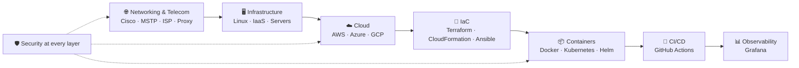

---

## 👨‍💻 About me

My background is in **Telecommunications Engineering**, so I understand infrastructure **from the physical layer all the way up to the application**: how a packet travels across an ISP network, how a server is provisioned in the cloud, how a container is deployed on Kubernetes, and how to secure all of it.

I work at the intersection of **Cloud, DevOps, Networking and Cybersecurity**. I automate infrastructure with **Terraform, Ansible and CloudFormation**, orchestrate services with **Docker and Kubernetes**, and practice offensive security in isolated labs so I can design systems that are harder to break.

---

## 🎯 Why work with me?

<table>
<tr>
<td width="50%" valign="top">

### 🧩 End-to-end vision

I don't see infrastructure in silos. When something breaks, I can trace the problem **from the network to the server, from the server to the container, and from the container to the pipeline**, without needing five different people.

- I speak the language of **networking**, **systems**, **development** and **security**.
- I design with the whole system in mind: cost, availability, security and operations.
- I act as a bridge between infrastructure and development teams.

</td>
<td width="50%" valign="top">

### ⚡ Fast learner

My stack is broad because **I pick up new tools quickly and put them into practice**, not just into theory.

- I work with **three clouds**: AWS, Azure and GCP.
- I use **three IaC approaches**: Terraform, CloudFormation and Ansible.
- Every project I build is **documented with evidence**, so anyone on the team can reproduce it.

</td>
</tr>
</table>

### 🗺️ My end-to-end view of infrastructure

---

## 💼 What I bring to your team

| Area | What I can do |
|---|---|
| ☁️ **Cloud** | Design and deploy infrastructure on AWS, Azure (IaaS, AKS, Functions) and GCP. |
| 📜 **Infrastructure as Code** | Turn manual infrastructure into versioned, repeatable, reviewable code. |
| 📦 **Containers** | Package applications with Docker and run them on Kubernetes with Helm and network policies. |
| 🔄 **Automation** | Build CI/CD pipelines and automate server configuration with Ansible. |
| 🌐 **Networking** | Configure and troubleshoot networks (Cisco, MSTP, proxies) with a telecom engineering mindset. |
| 🛡️ **Security** | Find vulnerabilities in a lab environment and apply those lessons to system hardening. |
| 📊 **Operations** | Monitor services with Grafana and document processes so the team can repeat them. |

---

## 🛠️ Tech stack

### ☁️ Cloud

<table>
  <tr>
    <td align="center" width="120"> <b>AWS</b> CloudFormation</td>
    <td align="center" width="120"> <b>Microsoft Azure</b> IaaS · AKS · Functions</td>
    <td align="center" width="120"> <b>Google Cloud</b> GCP</td>
    <td align="center" width="120"> <b>Firebase</b> Backend as a Service</td>
  </tr>
</table>

### ⚙️ DevOps & Infrastructure as Code

<table>
  <tr>
    <td align="center" width="120"> <b>Terraform</b></td>
    <td align="center" width="120"> <b>Ansible</b></td>
    <td align="center" width="120"> <b>Docker</b></td>
    <td align="center" width="120"> <b>Kubernetes</b></td>
  </tr>
  <tr>
    <td align="center" width="120"> <b>Helm</b></td>
    <td align="center" width="120"> <b>GitHub Actions</b></td>
    <td align="center" width="120"> <b>Nginx</b></td>
    <td align="center" width="120"> <b>Grafana</b></td>
  </tr>
</table>

### 🛡️ Cybersecurity

<table>
  <tr>
    <td align="center" width="120"> <b>Kali Linux</b></td>
    <td align="center" width="120"> <b>Metasploit</b></td>
    <td align="center" width="120"> <b>Wireshark</b></td>
    <td align="center" width="120"> <b>VirtualBox</b></td>
  </tr>
</table>

### 🌐 Networking & Telecommunications

<table>
  <tr>
    <td align="center" width="120"> <b>Cisco Networking</b></td>
    <td align="center" width="120"> <b>Linux</b></td>
    <td align="center" width="120"> <b>Ubuntu</b></td>
    <td align="center" width="120"> <b>Bash</b></td>
  </tr>
</table>

| Concept | Experience |
|---|---|
| 🔀 **MSTP** | Designing redundant, loop-free switched networks. |
| 🏢 **ISP** | Architecture and operation of service provider networks. |
| 🧭 **Proxy Server** | Configuring proxies for traffic control and security. |
| 📡 **Computer Networking** | TCP/IP model, addressing, segmentation and network troubleshooting. |

### 💻 Languages, databases & tools

<table>
  <tr>
    <td align="center" width="120"> <b>Java</b></td>
    <td align="center" width="120"> <b>Python</b></td>
    <td align="center" width="120"> <b>JavaScript</b></td>
    <td align="center" width="120"> <b>Node.js</b></td>
  </tr>
  <tr>
    <td align="center" width="120"> <b>MySQL</b></td>
    <td align="center" width="120"> <b>PowerShell</b></td>
    <td align="center" width="120"> <b>Git</b></td>
    <td align="center" width="120"> <b>GitHub</b></td>
  </tr>
  <tr>
    <td align="center" width="120"> <b>IntelliJ IDEA</b></td>
    <td align="center" width="120"> <b>VS Code</b></td>
    <td align="center" width="120"> <b>Cucumber / Gherkin</b></td>
    <td align="center" width="120"> <b>HTML / CSS</b></td>
  </tr>
</table>

### 🤝 Professional skills

  
  
  
  
  

---

## 🚀 Featured projects

| Project | What it does | What it shows | Stack |
|---|---|---|---|
| ☸️ [**AKS-Cluster**](https://github.com/Juansex/AKS-Cluster) | Provisions a Kubernetes cluster on Azure and publishes an Nginx app with 3 replicas behind a LoadBalancer. | Cloud + IaC + orchestration in a single automated flow. | Terraform · Azure · Kubernetes |
| ⚡ [**Lab_Terraform**](https://github.com/Juansex/Lab_Terraform) | Deploys a serverless Azure Function with an HTTP trigger, 100% as code. | Serverless architecture, security best practices (TLS 1.2+) and reusable outputs. | Terraform · Azure Functions · Node.js |
| 🔐 [**pentest-home-lab**](https://github.com/Juansex/pentest-home-lab) | Isolated pentesting lab with Kali Linux and Metasploitable 2 on an internal network with no Internet access. | Isolated network design, professional ethics and evidence-based documentation. | Kali · VirtualBox · Networking |
| 🌐 [**Networking_policies**](https://github.com/Juansex/Networking_policies) | Segments a 3-tier app (Nginx → API → PostgreSQL) with default-deny network policies on Kubernetes. | Principle of least privilege applied to container networking. | Kubernetes · Shell |
| 📦 [**Helm-charts**](https://github.com/Juansex/Helm-charts) | Packages and deploys applications on Kubernetes with Helm, including a scan-exporter. | Repeatable, versioned deployments. | Helm · Kubernetes |

---

## 🧭 How I work

- **I automate everything that repeats.** If I've done it by hand twice, the third time it's code.
- **Security by design**, not as a patch at the end.
- **I document with evidence**, so the team can reproduce, audit and maintain what I build.
- **I understand the whole problem** before choosing the tool.

## 🌱 What I'm working on now

- 🔍 Enumeration and vulnerability analysis with Nmap in my pentesting lab.
- 🔒 Kubernetes cluster hardening and network policies.
- 📊 Service observability with Grafana.

---

## 📫 Let's talk

Looking for someone who understands your infrastructure end to end and quickly learns whatever your team needs? **Reach out.**

<!-- Add your LinkedIn here:

-->

